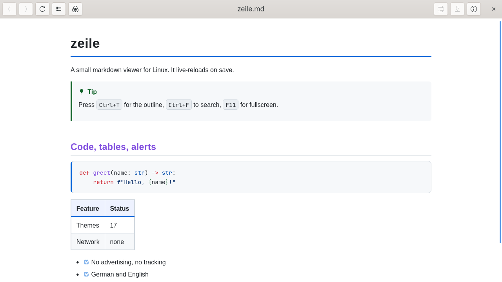
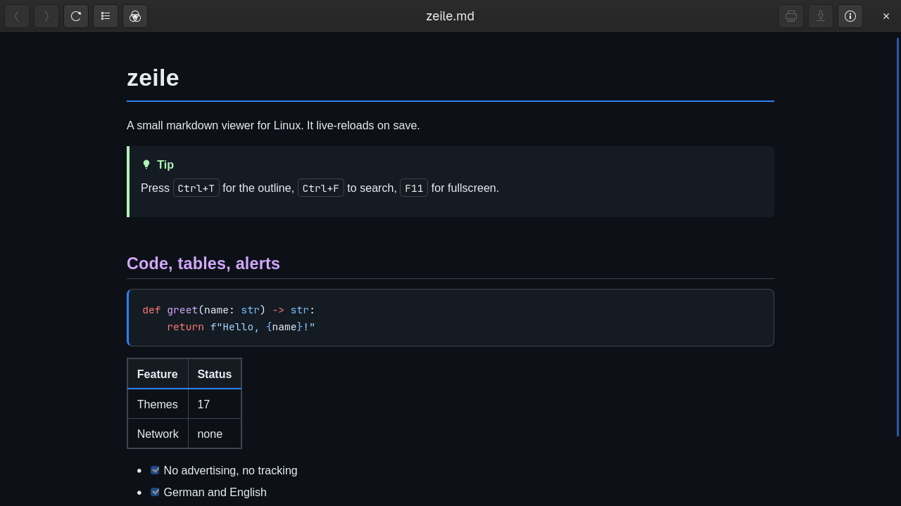
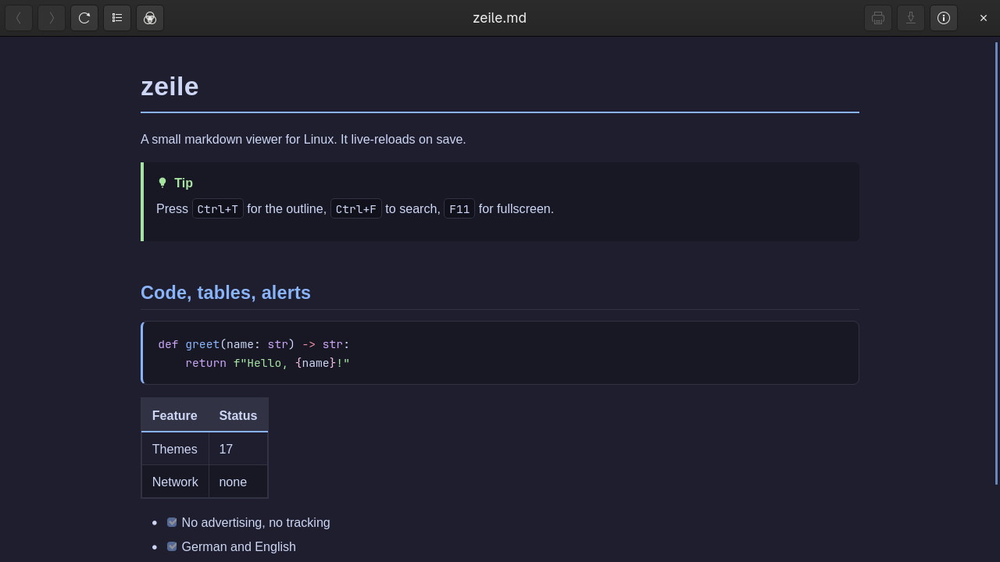
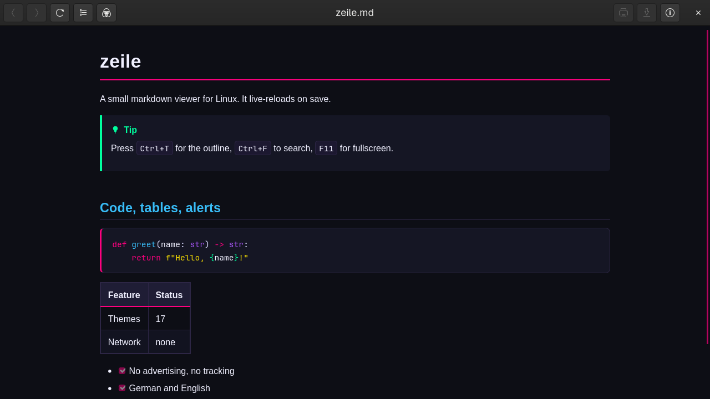

# zeile

A small GTK4 markdown viewer for Linux, with Mermaid diagram support.

[](https://github.com/DnaMes/zeile/actions/workflows/ci.yml)


> **No advertising. No tracking. No analytics. No unnecessary permissions.**

<p align="center">
  
  
</p>
<p align="center">
  
  
</p>

## Why

Markdown viewers are either terminal-only (no diagrams), full editors, or
full note-taking apps with far more surface than "look at this file". This
one does one thing: render a `.md` file, live-reload it on save, and get out
of the way. Built on the GTK4 and WebKitGTK already on the system, so it
starts fast and stays readable, no bundled browser engine.

A `.md` file is untrusted content by the time it reaches this app (it's the
double-click default handler for `text/markdown`), so the rendered document
runs with document JavaScript structurally disabled, an explicit HTML
sanitizer allowlist, no persistent storage, and no network access beyond
handing a clicked link to your actual browser. See Security below.

## Install

Zeile needs GTK4, WebKitGTK 6.0 and a few Python libraries (see
[Requirements](#requirements)). Then, from a checkout or a release archive:

```bash
./install.sh
```

`install.sh` checks the dependencies first and prints the exact package line for
your package manager if one is missing. It writes:

| Path                                                   | What                               |
| ------------------------------------------------------ | ---------------------------------- |
| `~/.local/bin/zeile`                                   | launcher (pins `/usr/bin/python3`) |
| `~/.local/share/applications/zeile.desktop`            | desktop entry + mime association   |
| `~/.local/share/icons/hicolor/scalable/apps/zeile.svg` | icon                               |
| `~/.local/share/icons/hicolor/*/apps/zeile.png`        | PNG icon sizes 16×16 to 512×512    |

Then it sets itself as the default handler for `text/markdown`, so double-clicking
a `.md` file in the file manager opens it. `./install.sh --uninstall` removes it again.

### Packages

Each release also carries a `.deb` (Debian 13) and a `.rpm` (Fedora) built in CI. System
packages install under `/usr` and never claim the markdown default handler; opt in with
`xdg-mime default zeile.desktop text/markdown text/x-markdown`.

| Target | How |
| ------ | --- |
| Arch | `packaging/PKGBUILD` (`makepkg -si`) |
| Debian 13 | `sudo apt install ./zeile_VERSION_all.deb` (build it yourself with `packaging/debian/build-deb.sh`). Ubuntu 24.04 has no `python3-nh3` package, so install `nh3` with pip first and use `./install.sh` instead of the `.deb`. |
| Fedora | `sudo dnf install ./zeile-VERSION-1.fc43.noarch.rpm` (build it with `packaging/rpm/build-rpm.sh`) |
| Flatpak | `flatpak-builder --user --install --force-clean build-dir packaging/flatpak/com.erdlabs.zeile.yml`. Flathub is not published yet. |

The Flatpak has read-only access to your home directory (so a document can show the images
next to it) and no network access. `--enable-mermaid` is not available in the Flatpak: the
`mmdc` helper lives outside the sandbox.

`scripts/package-check.sh deb|rpm|arch` builds a package in a clean container, installs it and
starts the viewer headless; the Flatpak is built and started with the command above.

## Usage

```bash
zeile README.md                    # GUI window
zeile --enable-mermaid README.md   # render mermaid diagrams (needs mmdc, see below)
zeile --debug README.md            # enable WebKit developer tools
zeile --theme rose-pine README.md    # open with a specific theme (also saved)
zeile --body-font inter README.md    # set body font for this run
zeile --code-font jetbrains-mono README.md
```

`ZEILE_DEBUG=1` is equivalent to `--debug`.

`man zeile` (English and German) documents every option; completions for bash, zsh and
fish are installed by the packages and, for bash and fish, by `./install.sh`.

| Shortcut                 | Action                                                    |
| ------------------------ | --------------------------------------------------------- |
| `Ctrl+R`                 | reload                                                    |
| `Ctrl+W` / `Ctrl+Q`      | close                                                     |
| `Ctrl++` / `Ctrl+-`      | zoom                                                      |
| `Ctrl+0`                 | reset zoom                                                |
| `Ctrl+F`                 | find in page                                              |
| `Alt+Left` / `Alt+Right` | back / forward through visited local links                |
| `Ctrl+T`                 | table of contents overlay (filter outline, stats, jump)   |
| `Ctrl+P`                 | print                                                     |
| `F11`                    | toggle fullscreen mode                                    |
| `F1`                     | list of keyboard shortcuts (Esc or `F1` closes it)        |

The header bar also has a PDF export button (save-location picker, then
straight to a PDF file — no print dialog in between).

The file is watched, so edits in another editor re-render automatically
(debounced by 120 ms, because editors write in bursts). Clicking a link to
another local `.md` file navigates to it in the same window, with back/
forward history — the target file is watched instead, and the original stays
one `Alt+Left` away.

## Features

- GitHub-style CSS, light and dark following `prefers-color-scheme`
- 20 curated themes (GitHub Light/Dark, Catppuccin ×4, Solarized ×2,
  Gruvbox ×2, Nord, Dracula, Rosé Pine ×2, Tokyo Night ×2, Cyberpunk,
  VS Code Dark, One Dark, Monokai) plus an "Auto" mode following the system; pick in the header-bar palette button
  or via `--theme`. The selection persists in `~/.config/zeile/settings.json`
  (theme, fonts, zoom, window size and whether the erdlabs intro has played;
  no document content).
- Start sequence: on the first start after install the erdlabs mark fades in
  and out (about 3 s), then the zeile logo fades in and out (about 1.4 s) as a
  skippable overlay while the document window opens underneath. Both play once
  per install (`intro_seen` in `settings.json`); later starts go straight to
  the document (BRAND.md §7). Any key or click skips the whole sequence; with
  GTK animations off the frames show without fades.
  The version number appears only in the About dialog (header-bar help button).
  No sound, no network, no tracking.
- Body and code font pickers with graceful fallback stacks: Inter, Atkinson
  Hyperlegible, iA Writer Quattro, Noto Serif, IBM Plex Sans; JetBrains Mono,
  iA Writer Mono, Fira Code, Cascadia Code. Fonts are used if installed and
  silently fall back if not.
- Reading width (narrow / standard / wide) for the document column, picked in
  the same palette popover and persisted with the other UI preferences
- Readability polish: color-coded heading hierarchy (`h1`–`h6`), accent-bordered
  code blocks (`3.5px solid var(--accent)`), tinted blockquotes, zebra table rows
  with accent headers, accent `hr` gradients, styled `kbd` keycaps, themed text
  selection, focus outlines, print/PDF always renders on a light palette
- Tables, footnotes, definition lists, admonitions, GFM alerts (`> [!NOTE]`, `> [!TIP]`, etc.), TOC anchors and hover `#` permalinks
- Document statistics (word count, reading time) and real-time heading filter in the TOC popover
- Copy button on every code block (top-right on hover, keyboard-focusable,
  always visible on touch): clicking it copies the block's plain text to
  the system clipboard and flashes a check mark — implemented without any
  document JavaScript (see Security)
- Syntax highlighting via Pygments, plus automatic language detection for
  code blocks with no language tag: a rule-based detector (shebangs, JSON/
  YAML/TOML/INI/Dockerfile/diff structure, weighted per-language indicators)
  picks the language before rendering, so untagged fences still get
  coloured. Conservative by design — ambiguous or plain-text blocks stay
  unhighlighted instead of getting a confidently wrong colour
- Find-in-page shows a live match count next to the search entry
  ("No matches" when the term isn't in the document)
- Link hover preview: hovering over a link displays its target URI in a
  subtle floating status pill at the bottom-left before clicking
- Mermaid diagrams: fenced ` ```mermaid ` blocks render as real
  diagrams, opt-in via `--enable-mermaid`. Pre-rendered to static SVG by the
  `mmdc` CLI (`@mermaid-js/mermaid-cli`) at render time, cached by content
  hash, so the document view itself never runs a live JS diagram renderer —
  off by default so the base install needs no Node.js.
- Symlinks resolved: the window shows the name you opened, but watches the
  real target — monitoring a symlink itself never reports edits to its target

## Requirements

Python 3.11+, GTK4 and WebKitGTK 6.0 with their GObject bindings, plus
python-markdown, Pygments, nh3 and pymdown-extensions. Every line below is
exercised by the distro matrix in CI (Arch, Debian 13, Ubuntu 24.04, Fedora 43).

```bash
# Arch
sudo pacman -S --needed python-gobject webkitgtk-6.0 python-markdown python-pygments python-nh3 python-pymdown-extensions

# Debian 13
sudo apt install python3-gi gir1.2-gtk-4.0 gir1.2-webkit-6.0 python3-markdown python3-pygments python3-nh3 python3-pymdownx

# Ubuntu 24.04 (no python3-nh3 package: install it with pip)
sudo apt install python3-gi gir1.2-gtk-4.0 gir1.2-webkit-6.0 python3-markdown python3-pygments python3-pymdownx python3-pip
python3 -m pip install --user --break-system-packages nh3

# Fedora
sudo dnf install python3-gobject gtk4 webkitgtk6.0 python3-markdown python3-pygments python3-pymdown-extensions python3-nh3
```

The launcher hardcodes `/usr/bin/python3` on purpose: a `brew` or `mise`
python that comes first on `PATH` typically has no `gi` bindings, so
`import gi` fails under it.

`--enable-mermaid` additionally needs `mmdc` on `PATH`:

```bash
npm install -g @mermaid-js/mermaid-cli
```

This pulls a headless Chromium via Puppeteer (roughly 300 MB) — that's why
it's a separate opt-in step and not part of the base install. Without
`--enable-mermaid`, fenced ` ```mermaid ` blocks render as plain text instead
of a diagram; with `--enable-mermaid` but no `mmdc` on `PATH`, they render a
clear error instead of silently failing.

#### Print / PDF export

The print dialog and PDF export need GTK4's print backends. Some recent GTK 4
builds (e.g. Arch's `gtk4 1:4.22.4`) no longer ship them; on such systems zeile
detects that at start-up and shows both buttons disabled with a tooltip instead of
failing silently. Everything else is unaffected.

## Security

A markdown file you open here is not assumed to be something you wrote or
trust — it's whatever a double-click on `.md` handed to this app. That
shapes every decision below, each one verified against the real WebKitGTK
API, not assumed:

- **Document JavaScript is structurally disabled** (`enable-javascript-markup
= False`), so a `<script>` or `onerror=` embedded in the source cannot run,
  independent of the sanitizer below. The app's own `evaluate_javascript()`
  calls (scroll position) still work — they never evaluate anything sourced
  from the document.
- **The converted HTML is sanitized** (`nh3`/ammonia) with an explicit
  attribute allowlist: `<script>`, all `on*` handlers, `javascript:`/`data:`
  URLs, `<iframe>`/`<object>`/`<embed>`, and `<style>` blocks are stripped
  from anything the markdown source embeds directly, while headings keep
  their anchor `id`, code blocks keep their Pygments `class`, and footnotes
  keep their `id`/`href` pairs.
- **A Content-Security-Policy** (`default-src 'none'`) is set on the
  generated document, closing the one vector that needs no script at all —
  an `` beacon.
- **No network access** (with `--enable-mermaid` the opt-in `mmdc` helper, which
  runs a headless Chromium, is the one external process and is not network-isolated
  by zeile). The WebView uses an ephemeral `NetworkSession` (no
  persisted cookies or cache), and a navigation-policy handler only allows
  `file://` links under the open document's own directory — anything else
  (`http(s)`, or a `file://` path outside that tree) is handed to your
  system's default opener instead of being loaded in this window.
- **No persistent storage** — HTML5 local storage and the HTML5 database are
  both off, so a `.md` file can't plant an identifier that survives across
  opens.
- **Developer tools are off by default**, behind `--debug`/`ZEILE_DEBUG`.
- **The code-copy button uses no document script.** It is an `<a>` with a
  `zeile-copy://` URI injected after sanitization; the click arrives as a
  plain HTML navigation attempt in the policy handler, which puts the
  block's text on the GTK clipboard. A document forging its own
  `zeile-copy:` link can at worst copy a block of its own content.

## Internationalization

The UI is available in English and German, following your system locale
(`LANGUAGE`/`LANG`). Translations live in `po/de.po`; `install.sh` compiles
them to `locale/<lang>/LC_MESSAGES/zeile.mo` if `gettext` is available.

## Files

```
zeile.py                the app
markdown_ext.py          mermaid fence extraction + unlabeled-fence language hints (markdown preprocessor)
code_lang.py             rule-based language detection for untagged code blocks
mermaid_render.py        mmdc subprocess wrapper, content-hash cache
assets/style.css         rendering stylesheet
assets/themes.css        theme + font variable definitions
assets/zeile.svg         icon
po/de.po                 German translation
install.sh               installer (also: --uninstall)
scripts/screenshots.py   renders the README screenshots headless (docs/screenshots/)
packaging/               PKGBUILD, Flatpak manifest, deb and rpm builds, shared stage.sh
```

## Build

There is nothing to compile for local development — `zeile.py` runs as-is via
the `/usr/bin/python3` interpreter the launcher pins. Release tags trigger
`.github/workflows/release.yml`, which validates the tag/version and publishes
a checksumed Linux source archive to the GitHub Release.

## Packaging & CI

- `packaging/PKGBUILD` — Arch/AUR package template (installs to
  `/usr/share/zeile`, never claims the markdown default handler on its
  own; users opt in via `xdg-mime`).
- `.github/workflows/ci.yml` — ruff, pytest and shellcheck on every push, plus the distro matrix
  (`scripts/distro-check.sh` in Arch, Debian 13, Ubuntu 24.04 and Fedora 43 containers).
- `.github/workflows/release.yml` — validates SemVer/tag consistency, runs the
  full test/lint/package checks, and publishes `zeile-VERSION.tar.gz` plus
  `SHA256SUMS` for every `vX.Y.Z` tag.
- `scripts/check_version.py` — checks the version copies in `pyproject.toml`,
  `zeile.py` and `packaging/PKGBUILD`; the release workflow refuses drift.

## Platform support

- **Linux:** supported. The source release, `install.sh` and Arch `PKGBUILD`
  use the system GTK4/WebKitGTK 6.0 stack.
- **Windows/macOS:** no native binaries are published yet. PyGObject/GTK4
  itself is available on both platforms, but this application requires
  WebKitGTK 6.0; the current packaging sources do not provide a supported
  Windows or macOS WebKitGTK runtime. A real port needs a platform-specific
  WebView boundary (Windows WebView2 and macOS WKWebView) before installers
  can be produced. The release pipeline intentionally publishes no fake
  cross-platform artifacts.

## Contributing

Issues and pull requests are welcome. Branches are named `<type>/<issue-nr>-<topic>`,
commits follow Conventional Commits, and a change is ready when `ruff check .`,
`ruff format --check .`, `pytest` and `shellcheck install.sh scripts/*.sh` pass.
User-visible strings go through `po/` (English and German). Report security
problems privately, see [SECURITY.md](SECURITY.md).

Release flow: bump the version in `pyproject.toml`, `zeile.py` and
`packaging/PKGBUILD` together (`scripts/check_version.py` verifies the three
copies), add the changelog entry, then push an annotated `vX.Y.Z` tag —
`.github/workflows/release.yml` validates the tag and publishes the checksumed
source archive. Nothing is tagged that did not ship.

Everything in this repository ships under GPL-3.0-or-later, and the icons and
logo are the author's own work.

## Licence

GPL-3.0-or-later. Copyright (c) 2026 erdlabs.

See also: [CHANGELOG.md](CHANGELOG.md), [PRIVACY.md](PRIVACY.md),
[SECURITY.md](SECURITY.md).

**Trademarks.** The GPL covers the code and the shipped icon files. The names
"erdlabs" and "zeile" and the erdlabs mark are not licensed for use as the name or
logo of a modified version: forks should pick their own name and logo.

Part of [erdlabs](https://erdlabs.com).
